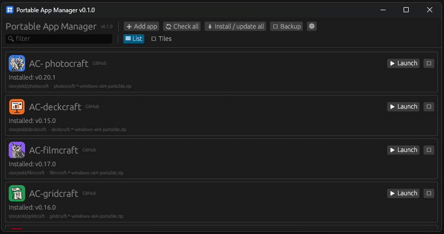
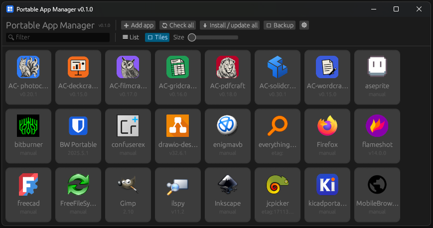
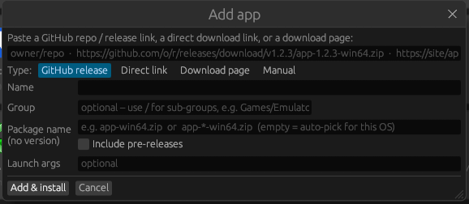

# Portable App Manager

A portable launcher and updater for your portable apps, written in Rust with [egui](https://github.com/emilk/egui).
Add an app once, then launch, update or remove it from one window. Everything is stored next to the exe.

> **Practice project.** This is a personal project I made to learn Rust, so expect rough edges.
>
> **Developed with AI tools.** It was written with the help of AI (Claude, by Anthropic).
> Most of the code is AI-generated, so please review it before relying on it. Bug reports and pull requests are welcome.

## Documentation
See the [`docs/`](docs/README.md) folder: user guide, sources and matching, building, and architecture.

## Features
- **Many sources**: GitHub repo / release, direct download link, custom download page, or fully manual.
- **Version-proof package names**: `app-win64.zip` matches `app-2.0.1-win64.zip`; wildcards (`app-*-win64.zip`) work too.
  Leave it empty to auto-pick the best file for your OS and CPU.
- **Launcher + manager**: launch, check for updates, update / install all, reinstall, open folder, edit, remove.
- **Archives**: `.zip`, `.7z`, `.tar.gz` / `.tgz` are extracted (a single top-level folder is flattened). Any other file (exe, AppImage) is copied as-is.
- **List and tile views** with app icons taken from the selected executable.
- **Groups**: nested folders in list view, Start-menu-style folder tiles in tile view.
- **Backup**: export / import your app list to set up another PC.
- **Safe removal**: deleting an app's files always asks for confirmation (the box starts unchecked).

## Build
Requires a recent stable Rust toolchain.
```
cargo build --release
```
The program is `target\release\portable-app-manager.exe`.

On Windows the app icon is embedded in the exe with the Windows SDK's `rc.exe` (installed with Visual Studio Build Tools).
If the SDK is missing, build with `PAM_SKIP_ICON=1` to continue without the exe icon.
Linux build deps for the file dialog / window: `libxkbcommon-dev libgtk-3-dev` (or rely on xdg-portal).

## Using it
Everything is stored in `pam-data/` next to the exe (override with the `PAM_DATA` environment variable):
`config.json`, `apps/<id>/` (each app's files) and `tmp/`.

### Adding apps
Paste into the single box; the type is auto-detected.

| You paste | Detected as |
|---|---|
| `owner/repo` or `https://github.com/owner/repo` | GitHub release (latest) |
| `https://github.com/o/r/releases/download/v1.2.3/app-1.2.3-win64.zip` | GitHub release; package name auto-set to `app-win64.zip` |
| `https://example.com/files/app.zip` | Direct link (updates detected via ETag / Last-Modified / size) |
| `https://example.com/downloads` | Download page (scrapes links; optional link and version regex) |
| *Manual* tab | Import a file you downloaded, link an existing program, or just create an empty folder |

**Empty folder (portable apps):** create the folder, install or copy the app into it, then use **⋮ → Detect executable** (or Edit) to pick the exe.

### Views, icons and groups
- **☰ List / ▦ Tiles** toggle on the second toolbar row (remembered). Tile size slider appears in tile view. Right-click a tile for more actions.
- **Icons** come from the selected exe. If there is none, an icon file next to it (`icon.png`, `<name>.png`, `.DirIcon`, `.ico`) is used, otherwise a coloured letter tile.
- **Groups**: set a *Group* in Add/Edit (`Games/Emulators` makes nested folders).

## Screenshots

| List view | Tile view |
|---|---|
|  |  |



### Moving to another PC
**⇅ Backup → Export app list…** writes a small JSON (sources, package names, groups, args; no files, no token).
On the other PC use **Import app list…**, then **⬇ Install / update all**. Duplicates are skipped.
To carry installed files and per-app settings too, copy the whole `pam-data/` folder.

## Changing the app icon
Replace `src/icon/icon.png` (square, ideally 256x256 or larger) and rebuild. `build.rs` turns it into the window icon and the exe icon.

## Version
Set in `Cargo.toml` (`version = "x.y.z"`). It appears in the window title, the top bar and Settings, together with the git hash and build date.

## Notes
- The exe is not code-signed, so Windows SmartScreen may warn on first run.
- Unauthenticated GitHub API calls are rate-limited; add a token in Settings if you track many repos.
- The manager can't update itself while running (Windows locks a running exe). Close it and replace the file.
- Updates extract over the existing app folder, so settings stored inside it survive.
